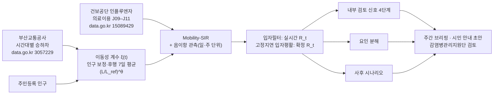
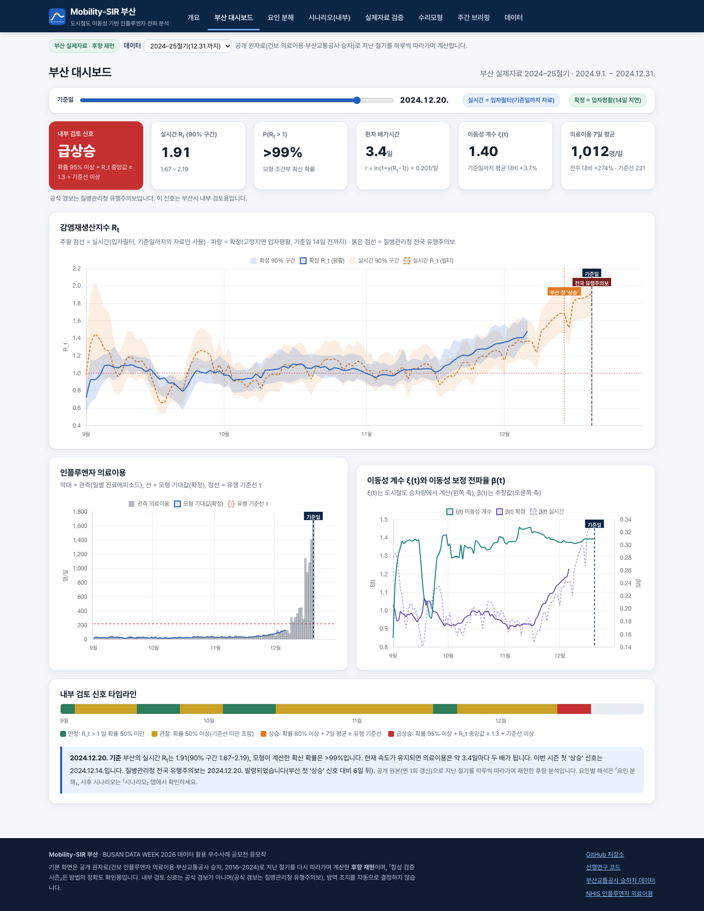
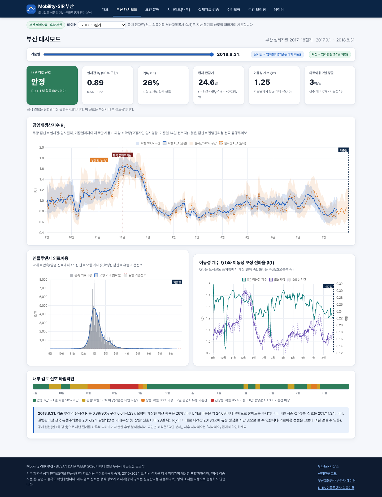
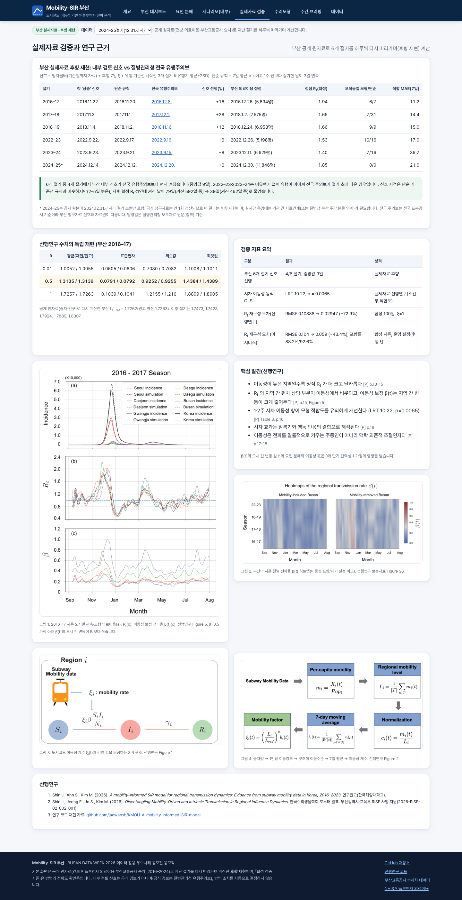
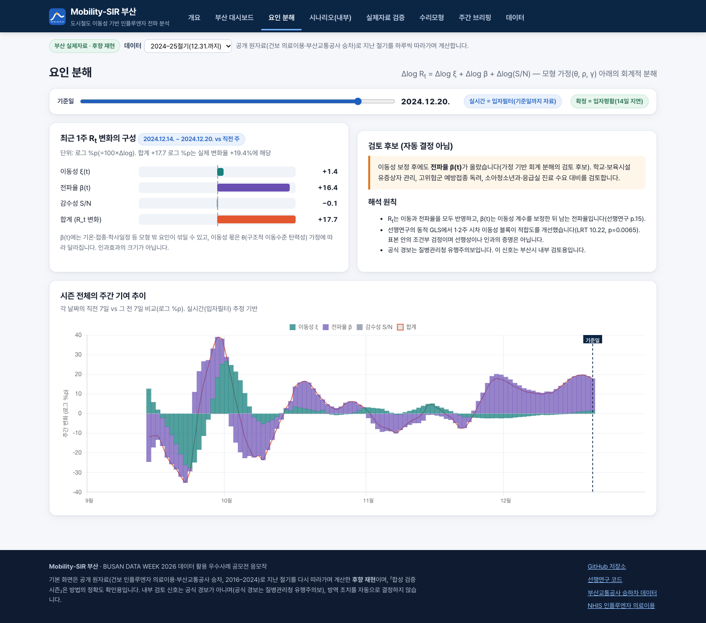
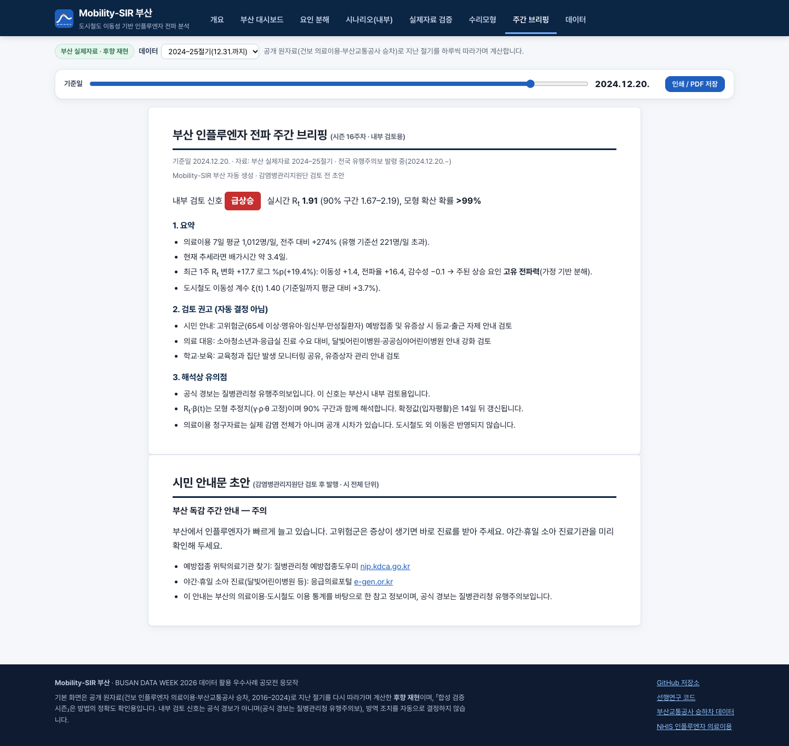
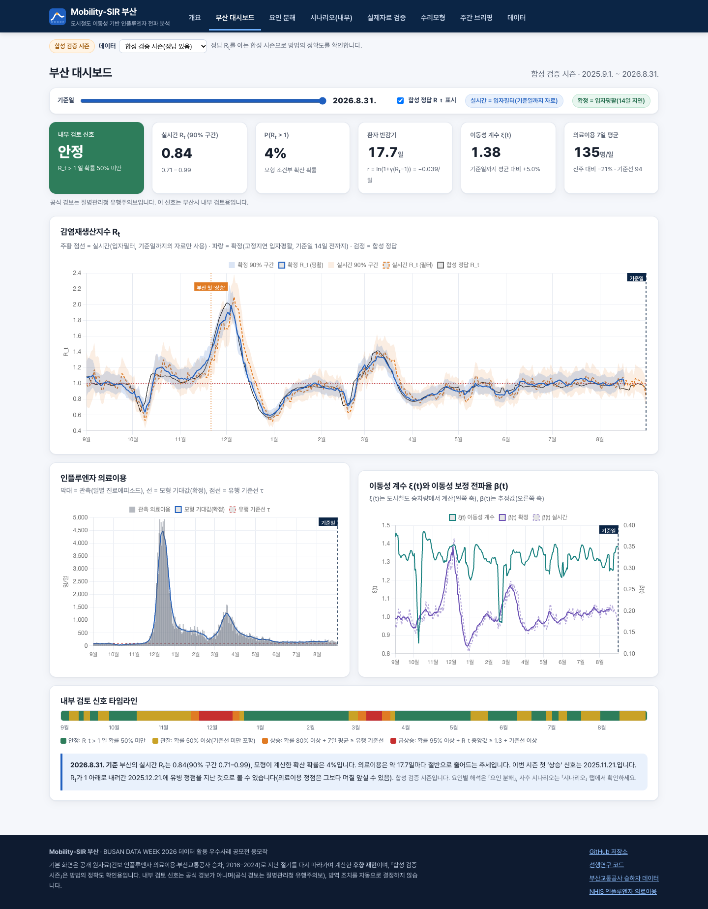
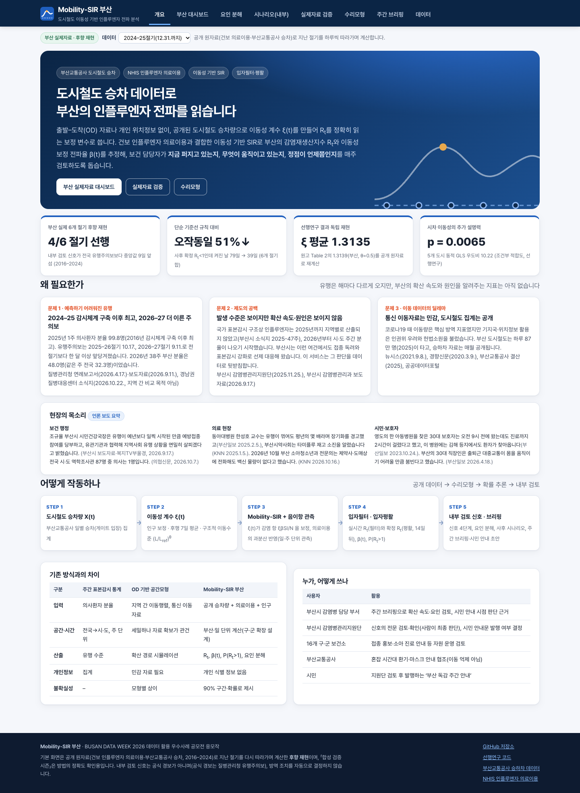
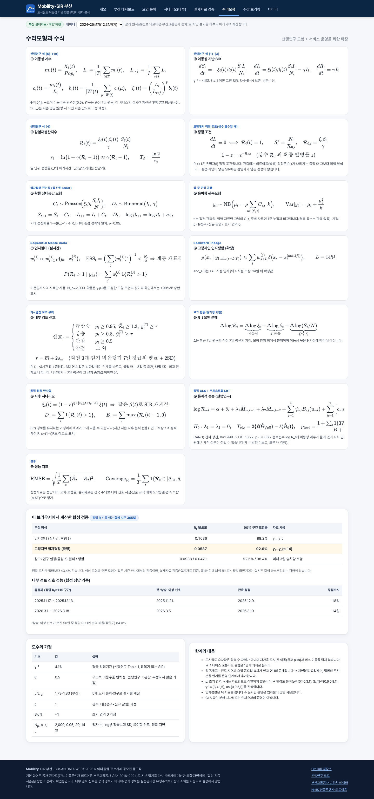
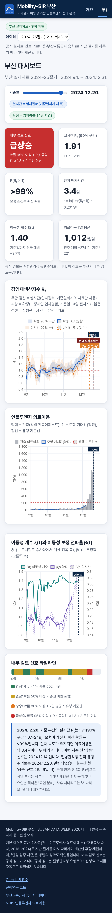

# Mobility-SIR 부산 — 도시철도 승차 데이터로 읽는 인플루엔자 전파 레이더

### 「BUSAN DATA WEEK 2026」 데이터 활용 우수사례 공모전 응모작
#### 주최 부산광역시 · 주관 (재)부산테크노파크 · 공모부문: 공공·빅데이터 및 민간 데이터 활용 분석 사례 및 서비스 제안

**서비스 바로가기 → https://shinshinjae.github.io/Mobility-SIR-Busan/**

---

### 개발 기간
- 선행연구(모형·5개 도시 실제자료 분석): 2025 ~ 2026.05 (한국수리생물학회 포스터 발표)
- 서비스 기획·웹 구현·부산 실제자료 후향 재현: 2026.10

---

## 프로젝트 개요

인플루엔자 유행은 해마다 다르게 옵니다. 2024–25절기 의사환자 분율은 2016년 감시체계 구축 이후 최고(1,000명당 99.8명)였고, 2026–27절기 유행주의보는 9월 11일로 전 절기보다 한 달 이상 일렀습니다. 국가 표본감시 구조상 인플루엔자는 2025년까지 지역별로 산출되지 않았고(부산시 소식지 2025-47주), 2026년부터 시·도 주간 분율이 나오기 시작했지만 **확산 속도와 원인**은 여전히 보이지 않습니다.

**Mobility-SIR 부산**은 매월 공개되는 **부산교통공사 도시철도 승차 데이터**로 이동성 계수 ξ(t)를 만들고, **국민건강보험공단 인플루엔자(J09–J11) 의료이용 자료**와 함께 이동성 기반 SIR 모형에 넣습니다. 음이항 관측모형과 입자필터·입자평활로 감염재생산지수 R<sub>t</sub>와 이동성 보정 전파율 β(t)를 추정해 부산시 보건 담당자의 주간 검토를 돕습니다.

| 질문 | 서비스 기능 |
|---|---|
| 지금 퍼지고 있는가? | 실시간 R<sub>t</sub>(90% 구간), P(R<sub>t</sub>>1), 배가시간, 내부 검토 신호 4단계 |
| 무엇이 움직이고 있는가? | Δlog R<sub>t</sub> = 이동성 + 전파율 + 감수성 (가정 기반 요인 분해) |
| 정점은 언제쯤인가? | 배가시간·반감기, 유병 정점 통과(R<sub>t</sub><1) 표시, 사후 시나리오 |

> 기본 화면은 **공개 원자료로 2016–2024년 부산 6개 절기를 하루씩 따라가며 계산한 후향 재현**입니다. 「합성 검증 시즌」은 정답 R<sub>t</sub>를 아는 상태에서 방법의 정확도를 확인하는 용도입니다. 내부 검토 신호는 공식 경보가 아니며, 공식 경보는 질병관리청 유행주의보입니다.

---

## 핵심 결과

### 1) 부산 실제자료 후향 재현 (2016–17 ~ 2024–25, 6개 절기)

| 절기 | 첫 ‘상승’ 신호 | 질병관리청 전국 유행주의보 | 신호 선행 | 부산 의료이용 정점 |
|---|---|---|---|---|
| 2016–17 | 2016.11.22. | 2016.12.8. | +16일 | 2016.12.26. |
| 2017–18 | 2017.11.3. | 2017.12.1. | +28일 | 2018.1.2. |
| 2018–19 | 2018.11.4. | 2018.11.16. | +12일 | 2018.12.24. |
| 2022–23 | 2022.9.22. | 2022.9.16. | −6일 | 2022.12.26. |
| 2023–24 | 2023.9.23. | 2023.9.15. | −8일 | 2023.12.11. |
| 2024–25* | 2024.12.14. | 2024.12.20. | +6일 | 2024.12.30. |

- 6개 절기 중 4개 절기에서 부산 내부 신호가 전국 유행주의보보다 먼저 켜졌습니다(중앙값 9일). 2022–23·2023–24는 비유행기 없이 유행이 이어져 주의보가 절기 초에 나온 경우입니다.
- 단순 기준선 규칙(7일 평균 ≥ τ, 1주 전보다 증가)과 비슷한 시점(2–5일 늦음)에 켜지면서, 사후 확정 R<sub>t</sub><1인데 켜진 날은 79일 → 39일로 줄었습니다.
- 선행연구 Table 2를 공개 원자료로 독립 재현했습니다: 부산 ξ(t) 평균 1.3135(원고 1.3139), L/L<sub>ref</sub> 1.7262(원고 역산 1.7263).
- \* 2024–25는 공개 원본이 2024.12.31.까지라 절기 초반만 포함. 공개 청구자료는 연 1회 갱신되므로 이 결과는 후향 재현이며, 실시간 운영에는 기관 간 자료연계가 필요합니다. 주의보 발령일은 질병관리청 보도자료 원문 기준입니다.

### 2) 선행연구(5개 도시·4개 절기, 실제자료)
- 1·2주 시차 이동성 블록의 추가 설명력: 동적 GLS 우도비 10.22, 부트스트랩 p = 0.0065 (표본 내 조건부 적합도, 인과 증명 아님)
- R<sub>t</sub> 재구성 오차(합성 100일, ξ=1): 입자필터 → 입자평활 RMSE 0.10888 → 0.02947

### 3) 합성 검증 시즌 (정답 R<sub>t</sub>를 아는 상태, 운영 설정 = 후행 ξ)
| 항목 | 결과 |
|---|---|
| R<sub>t</sub> RMSE: 입자필터 → 입자평활 | 0.104 → 0.059 (−43.4%) |
| 90% 구간 포함률: 필터 / 평활 | 88.2% / 92.6% |
| 첫 ‘상승’ 이상 신호 → 관측 정점 | 겨울 18일, 봄 14일 |
| ‘상승’ 이상 신호일의 정밀도 | 84.0% |

---

## 서비스 구조



## 시연 화면

| 부산 2024–25절기 (기준일 2024.12.20., 전국 주의보 발령일) | 부산 2017–18절기 시즌 전체 |
|---|---|
|  |  |

| 실제자료 검증 | 요인 분해 |
|---|---|
|  |  |

| 주간 브리핑·시민 안내 초안 | 합성 검증 시즌(정답 R<sub>t</sub> 표시) |
|---|---|
|  |  |

| 개요 | 수리모형 | 모바일 |
|---|---|---|
|  |  |  |

---

## 핵심 기능

1. **실시간 R<sub>t</sub> + 확정 R<sub>t</sub>** — 기준일까지의 자료만 쓰는 입자필터(실시간, 후행 7일 ξ)와 14일 뒤 갱신되는 고정지연 입자평활(확정)을 구분해 표시합니다.
2. **내부 검토 신호 4단계** — P(R<sub>t</sub>>1)과 유행 기준선 τ(직전 3개 절기 비유행기 평균+2SD)로 안정·관찰·상승·급상승을 판정하고, 3일 연속 조건으로 깜빡임을 막습니다. 질병관리청 유행주의보 발령일을 함께 표시합니다.
3. **요인 분해** — Δlog R<sub>t</sub> = Δlog ξ + Δlog β + Δlog(S/N)을 로그 %p로 보여 주고, 합계와 같은 방향의 요인만 주 요인으로 고릅니다(가정 기반 회계 분해).
4. **사후 시나리오(내부 분석)** — 지난 시즌에 ξ(t) → (1−r)<sup>η</sup>ξ(t)를 적용해 다시 계산하며 η=1(비례)·η<1(보수적)을 함께 보여 줍니다. 이동 억제를 권하지 않습니다.
5. **주간 브리핑·시민 안내 초안** — 담당자 검토용 한 장과, 감염병관리지원단 검토 후 발행할 시민용 안내문 초안을 자동 작성합니다.
6. **내 데이터로 분석** — CSV(일별 또는 주별 관측)를 올리면 브라우저 안에서만 계산합니다.

---

## 수리모형

이동성 계수 (선행연구 식 5–10)

$$m_i(t)=\frac{X_i(t)}{Pop_i},\quad L_i=\frac{1}{|T|}\sum_{t\in T}m_i(t),\quad c_i(t)=\frac{m_i(t)}{L_i},\quad b_i(t)=\frac{1}{|W(t)|}\sum_{\mu\in W(t)}c_i(\mu),\quad \xi_i(t)=\Big(\frac{L_i}{L_{ref}}\Big)^{\theta}b_i(t)$$

이동성 기반 SIR과 감염재생산지수 (식 1–4)

$$\frac{dS_i}{dt}=-\xi_i(t)\beta_i(t)\frac{S_iI_i}{N_i},\quad \frac{dI_i}{dt}=\xi_i(t)\beta_i(t)\frac{S_iI_i}{N_i}-\gamma I_i,\quad \mathcal{R}_i(t)=\frac{\xi_i(t)\beta_i(t)}{\gamma}\frac{S_i(t)}{N_i},\quad \gamma^{-1}=4.1\text{일}$$

확률 상태공간 모형과 음이항 관측(일·주 단위 공용)

$$C_t\sim\text{Poisson}\Big(\xi_t\beta_t\frac{S_tI_t}{N}\Big),\quad D_t\sim\text{Bin}(I_t,\gamma),\quad \log\beta_{t+1}=\log\beta_t+\sigma\varepsilon_t,\quad y_t\sim\text{NB}\Big(\rho\sum_{u\in(t',t]}C_u,\ k\Big)$$

입자필터 가중치와 확산 확률

$$w_t^{(j)}\propto w_{t-1}^{(j)}p(y_t\mid x_t^{(j)}),\qquad P(\mathcal{R}_t>1\mid y_{1:t})=\sum_j w_t^{(j)}\mathbb{1}\{\mathcal{R}_t^{(j)}>1\}$$

요인 분해와 시나리오

$$\Delta\log\mathcal{R}_t=\Delta\log\xi_t+\Delta\log\beta_t+\Delta\log(S_t/N),\qquad \xi_c(t)=(1-r)^{\eta}\xi(t)\ (t_0\le t<t_0+d)$$

전체 수식 13종과 가정(ρ=1, 초기 면역 0, θ=0.5)은 웹의 「수리모형」 탭에 있습니다.

---

## 데이터

| # | 데이터명 | 출처 | 활용 |
|---|---|---|---|
| 1 | 부산교통공사 시간대별 승하차인원 | [공공데이터포털 3057229](https://www.data.go.kr/data/3057229/fileData.do) | 승차 일별 합계 → ξ(t), 2016.1.–2024.12. |
| 2 | 국민건강보험공단 감염성질환(인플루엔자) 의료이용정보 | [공공데이터포털 15089429](https://www.data.go.kr/data/15089429/fileData.do) | 요양개시일 기준 시도별 일별 진료에피소드(외래입원 주부상병), 부산(26) |
| 3 | 행정안전부 주민등록 인구통계 | [jumin.mois.go.kr](https://jumin.mois.go.kr) | 연말 인구, 시즌 인구 = 두 해 평균 |
| 4 | 서울·대구·대전·광주 도시철도 승하차 | 각 운영기관 / 공공데이터포털 | 기준 이동수준 L<sub>ref</sub> |
| 5 | 질병관리청 인플루엔자 유행주의보 보도자료 | kdca.go.kr | 신호 시점 비교 기준 |

`analysis/build_real_data.py`가 원본 파일(xlsx·csv)에서 `docs/data/busan_real.json`을 만들고, `scripts/real_summary.mjs`가 검증 요약(`docs/data/validation_summary.json`)을 계산합니다.

---

## 기술 스택

| 분야 | 기술 |
|---|---|
| 웹 | HTML · CSS · JavaScript(ES Module), 서버 없는 정적 사이트 |
| 시각화 | Chart.js 4.4, KaTeX 0.16 |
| 계산 엔진 | 입자필터·고정지연 평활·음이항 우도(일·주 단위)·결정론적 SIR (`docs/assets/js/engine.js`) |
| 분석 | Python (NumPy, SciPy, pandas) — `analysis/msir` |
| 배포 | GitHub Pages (`main` 브랜치 `/docs`) |
| 검증 | Python 테스트 9종, Node 테스트 14종(구현 일관성), GitHub Actions |

## 저장소 구조

```text
Mobility-SIR-Busan/
├── docs/                      # GitHub Pages 루트 (웹 서비스)
│   ├── index.html
│   ├── assets/js/engine.js    # 계산 엔진 (브라우저·Node 공용)
│   ├── assets/js/app.js       # 화면 구성
│   └── data/                  # busan_real.json(실제자료), busan_demo.json(합성), validation_summary.json, research_reference.json
├── analysis/
│   ├── msir/                  # mobility.py, model.py, pf.py (Python 참조 구현)
│   ├── build_real_data.py     # 공개 원자료 → 부산 6개 절기
│   ├── build_demo_data.py     # 합성 검증 시즌
│   ├── build_research_reference.py
│   └── prepare_inputs.py      # 공공데이터 원본 → 업로드 CSV
├── scripts/                   # real_summary.mjs(검증 요약), screenshots.mjs(화면 캡처)
├── tests/                     # test_model.py, engine.test.mjs
├── image/                     # README·보고서용 화면
└── GITHUB_GUIDE.md            # 업로드·배포·확인 방법
```

## 로컬 실행

```bash
git clone https://github.com/shinshinjae/Mobility-SIR-Busan.git
cd Mobility-SIR-Busan
python3 -m http.server 8765 --directory docs
# 브라우저에서 http://localhost:8765 접속
```

## 검증 실행

```bash
python3 tests/test_model.py      # 또는 python -m pytest tests
node --test tests/engine.test.mjs
node scripts/real_summary.mjs    # 실제자료·합성 검증 요약 재계산
```

---

## 선행연구

- Shin J., Ahn S., Kim M. (2026). *A mobility-informed SIR model for regional transmission dynamics: Evidence from subway mobility data in Korea, 2016–2023.* 연구원고.
- Shin J., Jeong E., Jo S., Kim M. (2026). *Disentangling Mobility-Driven and Intrinsic Transmission in Regional Influenza Dynamics.* 한국수리생물학회 포스터 발표. 부산광역시·교육부 RISE 사업 지원(2026-RISE-02-002-001).
- 연구 코드: https://github.com/jaewansh/KMOU-A-mobility-informed-SIR-model

## 한계와 향후 계획

- 도시철도 승차량은 접촉 수 자체가 아니며 버스·자가용 이동을 담지 않습니다 → 시내버스 교통카드 결합을 1단계 과제로 둡니다.
- 청구자료는 연 1회 공개되고 진료 지연·요일 효과가 있습니다 → 질병청 부산 주간 분율 연계(엔진은 주 단위 관측 지원), 지연분포·요일계수 추가.
- ρ, 초기 면역, γ, θ는 자료만으로 식별되지 않습니다 → 민감도 분석. 요인 분해·시나리오·GLS는 인과효과의 증명이 아닙니다.

## 팀

S.I.D.Lab (Spatial Infectious Disease Dynamics Lab) — 구성원과 역할은 제출 시 기입합니다.

## 라이선스

코드는 MIT 라이선스입니다. `docs/assets/img`의 선행연구 그림 저작권은 원저자에게 있습니다. 데이터는 공공데이터포털 이용조건을 따릅니다.
